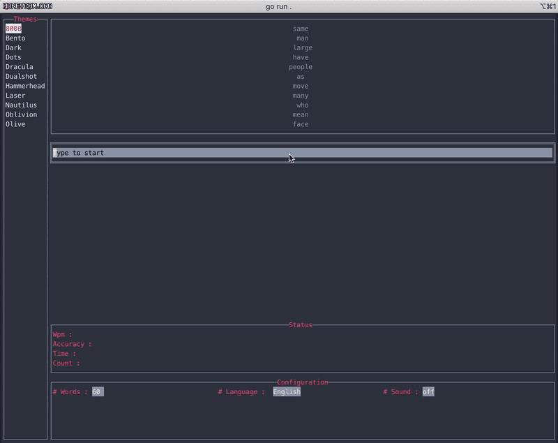

# gotypes

[](https://goreportcard.com/report/github.com/ralpioxxcs/gotypes)
[](https://github.com/ralpioxxcs/gotypes/actions?query=workflow%3A"build")

terminal based typing test application using golang inspirated by [monkeytype](https://monkeytype.com/)



## Features
* words (15/30/60/120), time (15/30/60s) and quote modes
* paragraph or tape (single scrolling line) text
* result screen: wpm, accuracy, raw, consistency, per-second chart
* languages: english, english1000, korean (also shows 타/분), polish
* settings and results are saved; the result screen shows your personal best per mode and language
  (`config.json` and `history.jsonl` in your OS config dir, e.g. `~/.config/gotypes` or `~/Library/Application Support/gotypes`)
* [gmk](https://www.gmk-electronic-design.de/en/products/keycaps) keycap themes plus nord, gruvbox, catppuccin, tokyo night, rose pine, solarized light

## Install
```
$ go install github.com/ralpioxxcs/gotypes@latest
```

## Usage
Run `gotypes` (or `go run .` in the source root) and start typing.

| key | action |
|---|---|
| <kbd>tab</kbd> | restart |
| <kbd>esc</kbd> | settings: mode, text, language, theme. Enter a category, type to filter, enter to apply (themes preview as you move) |
| <kbd>ctrl</kbd>+<kbd>w</kbd> / <kbd>alt</kbd>+<kbd>backspace</kbd> | delete word |
| <kbd>←</kbd> <kbd>→</kbd> or mouse | inspect a second on the result chart |
| <kbd>ctrl</kbd>+<kbd>c</kbd> | quit |

A truecolor terminal is recommended for accurate theme colors.

Korean quotes are proverbs and excerpts of public-domain works (김유정, 김소월, 이효석, 현진건) taken verbatim from [Korean Wikisource](https://ko.wikisource.org).

## Docker
```
docker run -it --rm -e "TERM=xterm-256color" placket/gotypes:latest
```

## Dependencies
* https://github.com/rivo/tview

## License
See [LICENSE](LICENSE) file
